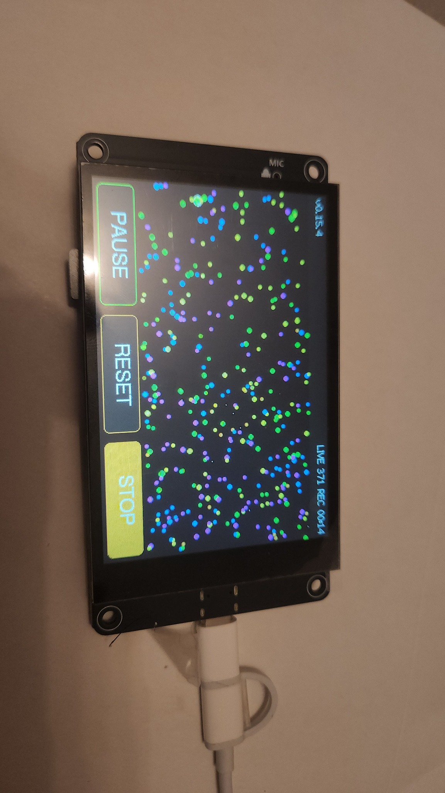
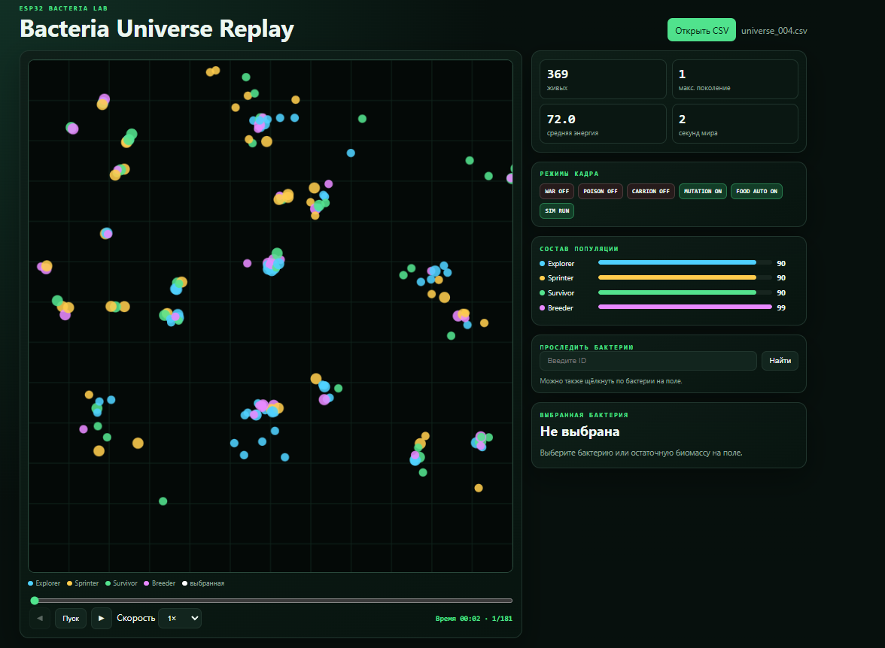
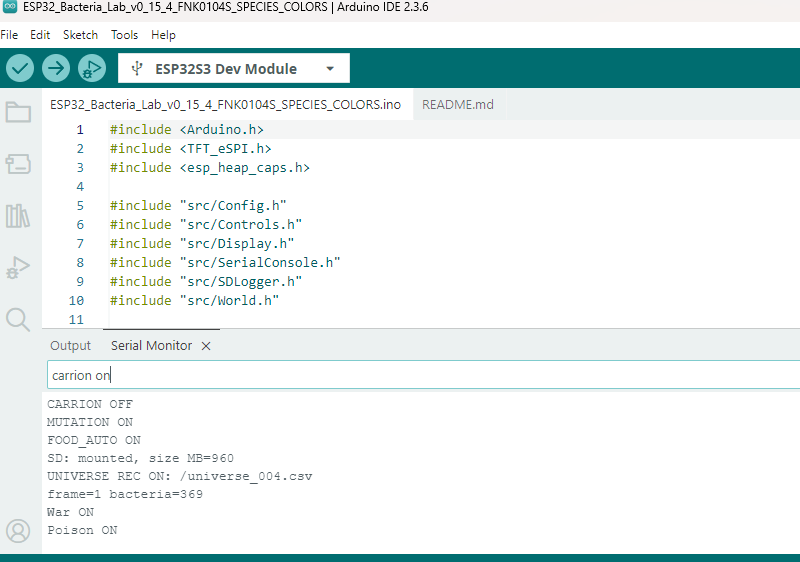

# ESP32 Bacteria Lab — FNK0104S

Artificial-life simulation for the **Freenove 4.0-inch ESP32-S3 Display — FNK0104S**.  
Симуляция искусственной жизни для платы **Freenove FNK0104S** с ESP32-S3.



## Аппаратная платформа

- ESP32-S3 с PSRAM;
- экран 4,0″, 320×480, контроллер ST7796;
- ёмкостный сенсор FT6336U;
- встроенный слот microSD, SDMMC 4-bit;
- профиль Arduino IDE: `ESP32S3 Dev Module`.

Прошивка предназначена именно для **FNK0104S**. Она не взаимозаменяема с
версией проекта для Freenove FNK0086.

## Возможности v0.15.4

- несколько сотен бактерий в реальном времени;
- энергия, возраст, питание, размножение и смерть;
- хемотаксис: движение к пище и остаточной биомассе, избегание яда;
- четыре наследуемых вида и мутации;
- родословные, поколения и уникальные ID;
- изменяемый размер бактерии в зависимости от энергии;
- остаточная биомасса с причиной гибели;
- включаемые системы `WAR`, `POISON`, `CARRION`, `MUTATION`, `FOOD AUTO`;
- тороидальный мир без стен;
- управление с сенсорного экрана и через Serial Monitor;
- полная запись состояния мира на SD каждую секунду;
- автономное воспроизведение CSV в браузере.

## Виды и цвета

| Вид | Цвет | Основная специализация |
|---|---|---|
| Explorer | голубой | дальний поиск ресурсов |
| Sprinter | жёлтый | высокая скорость |
| Survivor | зелёный | экономный обмен веществ |
| Breeder | фиолетовый | размножение |

Размер круга показывает запас энергии. Еда отображается белым цветом.



## Установка

Подробная инструкция находится в [docs/INSTALLATION_RU.md](docs/INSTALLATION_RU.md).

Главный файл прошивки:

`firmware/ESP32_Bacteria_Lab_v0_15_4_FNK0104S_SPECIES_COLORS/ESP32_Bacteria_Lab_v0_15_4_FNK0104S_SPECIES_COLORS.ino`

## Управление

На экране доступны кнопки:

- `PAUSE/RUN` — остановить или продолжить симуляцию;
- `RESET` — создать мир заново;
- `REC/STOP` — начать или завершить запись вселенной.

Serial Monitor: **115200 baud**, окончание строки **New Line**.

```text
help
systems
stats | stats on | stats off
genes | evolution | experiment reset
deaths | biomass
poison on | poison off | poison status
war on | war off
carrion on | carrion off | carrion status
list | show ID | next | predators
pause | run | food | reset
sd status | log on | log off | log now | snapshot
```



## Запись вселенной

`REC` или `log on` создаёт `universe_NNN.csv`. Первый кадр сохраняется сразу,
следующие — каждую секунду времени симуляции. В каждом кадре записываются:

- состояния всех режимов;
- все живые бактерии и их наследуемые параметры;
- активная остаточная биомасса;
- причины и время гибели;
- координаты, энергия, поколение, родословная и статистика.

Описание формата: [docs/CSV_FORMAT.md](docs/CSV_FORMAT.md).

## Bacteria Universe Replay

Откройте [viewer/Bacteria_Universe_Replay_v1_0.html](viewer/Bacteria_Universe_Replay_v1_0.html)
в Chrome или Edge и выберите `universe_NNN.csv`. Установка и интернет не нужны.

В папке `examples` находится короткая проверенная запись.

## Проверка релиза

Версия v0.15.4 испытана на реальной FNK0104S. Проверены четыре цвета,
сенсорное управление, Serial-команды, запись на SD и воспроизведение CSV.
Полный тест содержал 181 последовательный кадр с интервалом ровно одна секунда.

## Лицензия

[MIT](LICENSE)
